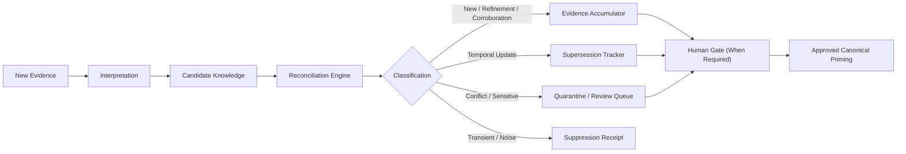
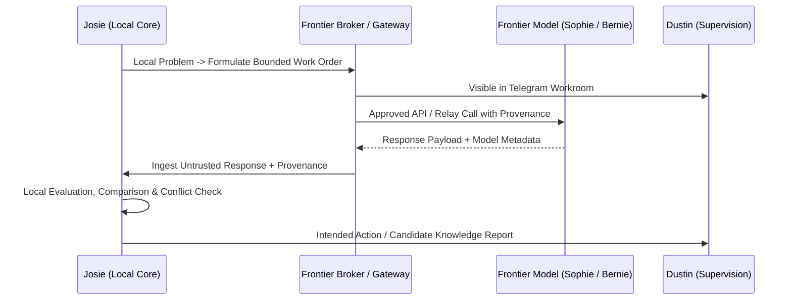
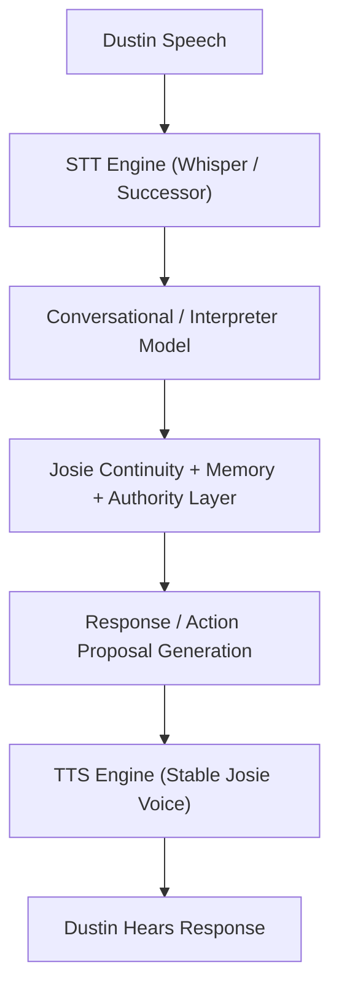

# Josie Continuity, Interface, and Evolutionary Learning Direction (2026-10-05)

**Status:** `RATIFIED FORWARD DIRECTION`  
**Authority:** Dustin's Explicit Project Decision (2026-10-05)  
**Scope:** Architecture, Interface, Continuity, Learning, Model Strategy, and Forward Roadmap  
**Governing Documents:** [JOSIE_CODEX_MASTER_CONTEXT.md](file:///D:/Josie/JOSIE_CODEX_MASTER_CONTEXT.md), [JOSIE_MASTER_BUILD_STATE.yaml](file:///D:/Josie/docs/JOSIE_MASTER_BUILD_STATE.yaml), [JOSIE_SETUP_CHECKLIST.md](file:///D:/Josie/docs/JOSIE_SETUP_CHECKLIST.md), [JOSIE_CONSTITUTION.md](file:///D:/Josie/docs/constitution/JOSIE_CONSTITUTION.md)

---

## Core Architectural Statement

> **Josie is not defined by one foundation model.**
>
> - **Josie's identity is persistent.**
> - **Josie's knowledge evolves.**
> - **Josie's relationships and history persist.**
> - **Josie's authority and permission system remain stable.**
> - **Josie's intelligence engines are replaceable.**
> - **Dustin remains final human authority.**
> - **Direct voice/text is the primary Dustin ↔ Josie relationship surface.**
> - **Telegram is the transparent project-team workroom.**
> - **Frontier models are collaborators/evidence sources, not Josie's identity.**
> - **Continuous learning must remain bounded, inspectable, provenance-aware, and local-first.**

---

## 1. Primary Dustin ↔ Josie Interface

Telegram is **NOT** Josie's primary Dustin-facing front door.

The long-term primary relationship surface is **direct Dustin ↔ Josie conversation**.

### Target Capabilities
- **Natural text conversation:** Low-latency, direct, unmediated communication channel between Dustin and Josie.
- **Speech-to-Text (STT):** Local or locally controlled transcription, initially Whisper or an appropriate qualified successor.
- **Text-to-Speech (TTS):** Expressive, stable Josie voice running locally or under direct local control.
- **Qualified Conversational/Interpreter Model:** A role-qualified local model capable of natural interpretation and dialogue.
- **Interactive Questioning:** Josie asking Dustin direct questions to clarify ambiguity, resolve conflicts, or unblock execution.
- **Natural Answering & Correction:** Dustin answering naturally in context, correcting Josie's understanding without needing manual schema edits.
- **Conversational Memory Editing:** Natural review, soft deletion, and editing of memories in dialogue.
- **Conversational State Management:** Creation and updates of goals, preferences, project facts, procedures, and current operational state through governed dialogue.
- **Governed Translation Layer:** Controlled translation of natural conversation into structured Josie state, candidate knowledge, and memory operations.

### Invariant
Natural language does **not** bypass memory provenance, authority, or consequential-action controls. Natural commands translate into auditable proposals, candidate assertions, or receipted mutations; they never grant arbitrary or uninspected execution authority.

**The Goal:** Dustin interacts directly with Josie as a persistent individual rather than primarily through forms, database commands, or an external team chat.

---

## 2. Telegram Role: The Transparent Project Team Workroom

Telegram serves as the transparent **Josie Project Team Workroom**.

### Mental Model
A shared team room / group chat (similar to Microsoft Teams, Slack, or Discord) where project participants assemble to collaborate under Dustin's oversight.

### Participants
- **Dustin** (Final Human Authority & Project Lead)
- **Josie** (Persistent Local AI & Orchestrator)
- **Sophie** (ChatGPT / OpenAI Historical Witness & Frontier Adviser)
- **Bernie** (Gemini / Google Historical Witness & Frontier Adviser)
- *Future participants may be added as explicitly approved.*

### Workroom Functions
- Project discussion and architectural alignment
- Task delegation and status reporting
- Collaborative planning and technical debates
- Questions and answers between participants
- Disagreements, multi-perspective evaluations, and trade-off comparisons
- Frontier-model consultations
- Review requests and gate sign-offs
- Dustin supervision, steerage, and real-time redirection

### Operational Visibility & Invariants
- **No Hidden Whispers for Project Work:** When Josie collaborates with Sophie or Bernie on Josie project work, prefer keeping that collaboration visible in the shared Telegram workspace where practical.
- **Complete Inspectability:** Dustin must be able to inspect at any moment:
  1. What was asked
  2. Who answered
  3. How the discussion developed
  4. What conclusion was reached
  5. What action Josie intends to take
- **Direct Redirection:** Dustin must be able to step in and redirect the team immediately without having to reconstruct hidden model-to-model backchannel conversations.
- Telegram is therefore **not** a private Josie chat replacement; it is the shared, accountable team room.

---

## 3. Operational Continuity: State & Meta-Narrative

Josie must maintain persistent structured operational continuity without continuously running a large model.

### Core Principle
> **"Persistent continuity != continuous GPU inference"**

Continuity is an architectural and data-layer property, not a spinning GPU loop. Josie maintains state deterministically across restarts, shutdowns, and idle periods without constant VRAM residency.

### Persistent Continuity Schema
Persist structured operational state including:
- **Active goals** (current objectives, milestones, parent/child linkages)
- **Active jobs** (running tasks, background workers, leases, timeouts)
- **Blockers** (dependencies, missing credentials, hardware gates, human gates)
- **Unresolved questions** (categorized by target: Dustin, Sophie, Bernie, or Research)
- **Things awaiting external events** (webhooks, file arrivals, time triggers)
- **Recent discoveries** (new system facts, environment observations)
- **Hypotheses** (unverified theories under evaluation)
- **Candidate memory changes** (staged knowledge mutations awaiting review)
- **Scheduled reconsiderations** (deferred items with trigger dates/conditions)
- **Repeated failures** (circuit-breaker state, backoff counters, failure signatures)
- **Capability gaps** (missing tools, untested APIs, uninstalled libraries)
- **Lessons from completed work** (post-mortem receipts, behavioral adjustments)

### Operational Meta-Narrative
Josie must always be capable of reconstructing her operational meta-narrative from structured state using an event-driven deterministic layer, waking model reasoning only when justified:
1. *What am I doing?*
2. *Why am I doing it?*
3. *What changed recently?*
4. *What am I waiting for?*
5. *What don't I understand?*
6. *What did Dustin recently teach or correct?*
7. *What failed, and why?*
8. *What did I learn from the last job?*
9. *What should happen next?*

---

## 4. Continuous Incremental Learning

The ChatGPT/Gemini Takeout import was bootstrap inheritance. Going forward, learning must be **continuous, incremental, and strictly governed**.

### Incremental Learning Pipeline


### Ingestion Sources
- Direct Dustin ↔ Josie conversation
- Telegram team conversation
- Job receipts and test outputs
- Repository changes and commit history
- System documents and manuals
- Approved web research
- Sophie (witness / adviser)
- Bernie (witness / adviser)
- Future approved models and diagnostic tools

### Governing Invariant
External model output is **evidence or advice**, never automatic truth or execution authority.

---

## 5. Purposeful Curiosity & Structured Question Ledger

Josie must learn continually without falling into open-ended, unguided, or resource-draining research loops.

### Purposeful Triggers
Curiosity is triggered only by concrete operational needs:
- Blocked work on an active goal
- Repeated execution or test failure
- Missing procedure or incomplete runbook
- Conflicting evidence between trusted sources
- Unclear Dustin intent or ambiguous instruction
- A capability gap relevant to an active goal
- Stale knowledge directly affecting current operations

### Structured Question Ledger Schema
Every inquiry is recorded as a first-class structured entity:
- `question_id`: Unique identifier
- `origin`: Event, job, or conversation turn that spawned the question
- `reason`: Concrete blocker, ambiguity, or goal justification
- `priority`: Urgency level (`P0` blocker to `P3` background enhancement)
- `allowed_sources`: Explicit allowlist (e.g., `["dustin"]`, `["sophie", "bernie"]`, `["local_docs"]`, `["web_official"]`)
- `attempts`: Counter tracking inquiries and evaluations made
- `state`: Lifecycle status (`open`, `dispatched`, `answered`, `deferred`, `closed`, `rejected`)
- `resolution`: Formal recorded conclusion and resulting candidate knowledge or action

---

## 6. Frontier Collaboration Architecture

Josie must be capable of formulating bounded, structured work orders and questions for frontier models (Sophie, Bernie, and future systems).

### Interaction Flow


### Governing Invariants
- Sophie and Bernie are **collaborators and advisers**.
- Neither model becomes part of Josie's identity, memory storage, or authority layer.
- All requests and responses are receipted, content-hashed, and cost-accounted.

---

## 7. Model Strategy & Decoupling Roadmap (Qwen Exit & Ornith Path)

Josie's architecture is provider-neutral and decouples intelligence engines from the core system.

### Principles
- **Temporary Role for Qwen:** Qwen may remain temporarily for already-validated roles, particularly the current historical-memory extractor (`qwen3:14b`). Qwen is **NOT** the desired permanent foundation.
- **No Single Vendor Dependency:** No dependency on Alibaba, OpenAI, Google, or any single vendor for Josie's identity, continuity, or operations.
- **Local Control:** Prioritize locally controlled model weights and open model artifacts with permissive licensing.
- **Provider-Neutral Interfaces:** Use standard local API abstraction layers (Ollama, llama.cpp, vLLM) so engines can be swapped without touching business logic.
- **Independent Role Qualification:** Models are evaluated and qualified independently by specific role. Do **NOT** globally swap models without role-specific validation against holdout benchmarks.
- **Ornith Path:** Ornith is currently a preferred successor candidate because it already outperformed Qwen in Josie's own qualification benchmarks. Prepare a structured evaluation path to qualify Ornith for resident generalist and memory roles.

### Role Matrix
1. **Conversation / Interpreter:** Low-latency dialogue, intent parsing, clarification synthesis.
2. **Memory Extraction & Reconciliation:** Epistemic classification, candidate claim extraction, corroboration.
3. **Operator / Planning:** Structured task decomposition, tool dispatch, plan verification.
4. **Coding:** High-accuracy differential source modification and test repair.
5. **Tool Use & Fast Dispatch:** High-speed schema validation and parameter binding.
6. **Classification & Filtering:** Inbound message routing, spam/noise suppression, sensitivity tagging.
7. **Summarization:** Context-minimized meta-narrative and session receipt generation.

---

## 8. Direct Voice Roadmap

The long-term primary interface for natural, embodied interaction between Dustin and Josie.

### Pipeline Architecture


### Conversational Memory Operations
The voice/text conversational surface must natively support memory interactions such as:
- *"Remember this changed."* (Trigger: candidate assertion update)
- *"That's not true anymore."* (Trigger: temporal supersession / invalidation)
- *"Why do you believe that?"* (Trigger: provenance and evidence inspection)
- *"What do you still need from me?"* (Trigger: blocker and open-question review)
- *"Update that memory."* (Trigger: conversational memory edit / correction)
- *"Ask Sophie and Bernie what they think."* (Trigger: bounded frontier work order dispatch)
- *"What are you waiting for?"* (Trigger: meta-narrative inspection of blocked jobs)
- *"Keep working on this unless you need me."* (Trigger: autonomous bounded run with fail-closed gates)

All conversational operations translate into governed, receipted state mutations; natural language never bypasses auditability.

---

## 9. Future Model Learning & Weight Adaptation Progression

Full weight training is explicitly deferred. Weight adaptation proceeds strictly through a gated, five-stage evolutionary progression:

```
┌─────────────────────────────────────────────────────────────────────────────┐
│ STAGE A: CONTEXT LEARNING                                                   │
│ Structured memory retrieval, dynamic context priming, system prompts,       │
│ explicit constitutional framing, and versioned runbook procedures.          │
├─────────────────────────────────────────────────────────────────────────────┤
│ STAGE B: BEHAVIORAL LEARNING                                                │
│ Persisting operational strategies, tool-use receipts, failure patterns,     │
│ remediation playbooks, and verified task heuristics in SQLite / Git.        │
├─────────────────────────────────────────────────────────────────────────────┤
│ STAGE C: POLICY ADAPTATION                                                  │
│ Using Dustin corrections, gate rejections, and adjudicated decisions to     │
│ refine deterministic filters, system prompts, few-shot exemplars, and rules. │
├─────────────────────────────────────────────────────────────────────────────┤
│ STAGE D: LoRA / ADAPTER EXPERIMENTS                                         │
│ Fine-tuning low-rank adapters on qualified locally controllable base models  │
│ only after sufficient high-quality curated training pairs and regression   │
│ test suites exist. Focus: conversation, evidence discipline, and extraction.│
├─────────────────────────────────────────────────────────────────────────────┤
│ STAGE E: SPECIALIZED WORKERS                                                │
│ Dedicated local models specialized for distinct sub-roles:                  │
│   - Josie Conversation   - Josie Memory                                     │
│   - Josie Operator       - Josie Code                                       │
│ All operate under unified Josie identity, memory, and authority layer.      │
└─────────────────────────────────────────────────────────────────────────────┘
```

---

## 10. Phased Forward Roadmap Order

The forward execution order across the upcoming development cycle is recorded as:

| Step | Milestone | Execution Category | Description |
|:---:|:---|:---:|:---|
| **1** | **Inheritance Closeout & Final Adjudication** | `NEXT` | Review and adjudicate the 35 consolidated items in `DUSTIN_FINAL_DECISION_QUEUE.md`. |
| **2** | **Canonical First-Generation Knowledge** | `NEXT` | Formally promote approved adjudicated candidates into canonical tables in `josie.db`. |
| **3** | **Continuity-State Schema** | `NEXT` | Implement persistent SQLite schema for goals, jobs, blockers, open questions, and meta-narrative. |
| **4** | **Event Queue & Scheduler** | `NEXT` | Build deterministic, event-driven task scheduler ("persistent continuity != continuous GPU inference"). |
| **5** | **Direct Dustin ↔ Josie Text Interface** | `NEXT` | Deploy low-latency direct text interface with conversational memory and state management. |
| **6** | **STT / TTS Direct Voice Conversation** | `CONSIDERING` / `NEXT` | Integrate local Whisper STT and stable local Josie TTS voice pipeline. |
| **7** | **Conversational Memory Editing & Questioning** | `LATER` | Native conversational commands for memory review, correction, and interactive clarification. |
| **8** | **Telegram Multi-Party Project Workroom** | `LATER` | Establish shared Telegram workroom for Dustin, Josie, Sophie, and Bernie. |
| **9** | **Transparent Josie / Sophie / Bernie Collaboration** | `LATER` | Implement multi-agent collaborative planning and public debate within the Telegram workroom. |
| **10** | **Bounded Reflection & Question-Management Loop** | `LATER` | Deploy the Purposeful Curiosity engine and structured Question Ledger. |
| **11** | **Frontier Intelligence Broker** | `LATER` | Governed API gateway dispatching bounded work orders to cloud frontier models with receipts. |
| **12** | **Continuous Incremental Evidence / Memory Intake** | `LATER` | Incremental evidence pipeline processing daily chat, git diffs, and documents. |
| **13** | **Model-Role Qualification & Qwen Exit Path** | `RESEARCH` / `LATER` | Benchmark Ornith and local candidates by role; execute phased Qwen migration. |
| **14** | **Josie Model Lab / Evaluation Corpus** | `RESEARCH` | Curate local regression suite, test harnesses, and holdout datasets for worker models. |
| **15** | **LoRA / Adapter Experiments** | `RESEARCH` | Controlled fine-tuning experiments on local base models for conversational and memory roles. |
| **16** | **Specialized Locally Controlled Workers** | `RESEARCH` | Swappable, specialized models (Conversation, Memory, Operator, Coder) under supervisor control. |

---

## Document Control & Provenance
- Created: 2026-10-05
- Source: Dustin's explicit forward architecture directive
- Hash / State Link: Captured in `docs/JOSIE_MASTER_BUILD_STATE.yaml` and tracked under git version control.
