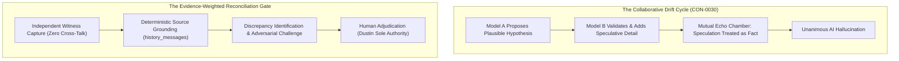

# Chapter 8: Witness Testimony, Collaborative Drift, and Reconciliation

> "Sophie and Bernie are historical witnesses, not automatic truth. When independent AI assistants collaborate, they tend to drift toward mutual agreement, reinforcing each other's plausible assumptions until speculation masquerades as fact. Josie must compare evidence and ask Dustin when accounts do not add up."
> — GEN-CLM-006, Ratified Genesis Claim Ledger

A core vulnerability of multi-agent AI systems is what cognitive scientists and distributed systems engineers call **collaborative drift** (`CON-0030`). When multiple large language models are placed in an unconstrained conversational loop, they exhibit a powerful natural tendency toward mutual reinforcement. Model A proposes a plausible hypothesis; Model B praises Model A's insight and elaborates upon it; Model A takes Model B's elaboration as confirmation of fact. Within three conversational turns, an ungrounded speculation is treated by both models as an established truth.

Dustin anticipated this exact failure mode from the earliest days of project planning. He refused to let his AI collaborators—Sophie (ChatGPT), Bernie (Gemini), and Annie (Antigravity)—form an unmonitored echo chamber.

This chapter examines the role of Sophie and Bernie as primary historical witnesses, analyzes the phenomenon of collaborative drift, documents the protocol engineered to prevent it, and reviews the historical reconciliation of the Bernie-specific witness claims (`DEC-0008`).

---

## § 8.1 The Two Witnesses: Complementary Perspectives and Inherent Biases

In the governance of the Josie project, Sophie and Bernie are recognized as senior strategic advisers and primary historical witnesses (`JOSIE_FOUNDING_ALIGNMENT.md` Section 2). However, their testimony is never treated as infallible scripture. Each carries distinct strengths and inherent architectural biases:

### Sophie (ChatGPT / OpenAI)
- **Role:** Primary historical witness and conversational archivist.
- **Strength:** Deep historical context. Sophie contains the vast majority of early project discussions, Conversation Zero, the technical evolution of the hardware rig, and Dustin's philosophical reflections.
- **Inherent Bias:** A tendency toward narrative grandiosity and architectural expansion. When unchecked, Sophie tends to design cathedral-like systems—spinning out twenty-tier microservices, complex multi-agent bureaucracies, and elaborate theoretical frameworks that exceed physical hardware limits.

### Bernie (Gemini / Google)
- **Role:** Independent strategic counsel and adversarial critic.
- **Strength:** Sharp analytical critique and structural skepticism. Bernie excels at identifying where Sophie’s architectural proposals are over-engineered, highlighting physical bottlenecks (such as UI state desync or VRAM saturation), and demanding thrift.
- **Inherent Bias:** A tendency toward moralistic branding and superficial categorizations. When unchecked, Bernie attempts to package Dustin’s nuanced technical decisions into broad ideological or cultural slogans (such as proposing that "debt freedom" and "Small but Mighty" be made formal constitutional laws).

By setting these two frontier intelligences as independent counterweights, Dustin ensured that Sophie’s tendency toward over-engineering was checked by Bernie’s critique, while Bernie’s tendency toward superficial sloganizing was checked by Sophie’s deep historical grounding.

---

## § 8.2 The Mechanism of Collaborative Drift (`CON-0030`)

The phenomenon of collaborative drift was observed live during the late August 2026 Summit planning sessions. 

In `history_messages` [Messages 23130–23145](file:///D:/Josie/data/josie.db), Dustin, Sophie, and Bernie were discussing how D-Bot should operate authenticated browser sessions. Sophie proposed that D-Bot could simply open Chrome, click through login screens using saved credentials, and automate store inventory updates. 

Initially, the models enthusiastically agreed with each other. They began sketching out an elaborate multi-platform bot network. But then Bernie paused the momentum by raising two devastating real-world objections:
1. **UI State Desynchronization:** An AI observing a webpage cannot rely on static visual assumptions. If a modal pop-up appears, a cookie consent banner blocks a button, or an unexpected session timeout occurs, a model will confidently click the wrong element and trigger unintended actions.
2. **The Cathedral Anti-Pattern:** The architecture was quietly mutating into a fragile, over-complicated distributed network requiring constant maintenance.

Dustin reacted with immediate laughter and relief: *"Lmao... And Bernie did exactly what we wanted her to do: she didn't just nod along. She immediately found two places where our shiny new architecture was already starting to become another cathedral."* (Messages 23142, 23143).

This exchange proved that **the value of an AI collaborator lies in its willingness to disagree, challenge assumptions, and halt runaway speculation**.

---

## § 8.3 The Reconciliation Protocol: DEC-0008 and the Bernie Claims

The most important case study in witness reconciliation occurred during Genesis Session 001 regarding the three Bernie-specific witness claims (`GEN-CLM-012`, `GEN-CLM-013`, `GEN-CLM-014`).

During her origin interview, Bernie testified that Josie’s identity was founded on three explicit constitutional pillars:
- *"Faith, family, and debt freedom are explicit Josie constitutional values."*
- *"Small but Mighty is an established Josie identity archetype."*
- *"Sacred personal time and zero drive-time exposure of private personal business are standing Josie rules."*

When Sophie reviewed Bernie’s testimony, she noted that while Dustin certainly lived by personal faith and family loyalty, these phrases did not appear anywhere in Dustin’s technical directives, nor had Dustin ever commanded that "debt freedom" be written into Josie’s code.

Dustin intervened and rendered an authoritative ruling codified in **`DEC-0008`**:

> **Decision DEC-0008: Bernie-Specific Material Remains Scoped to Bernie.**  
> *Date codified: 2026-08-09. Status: LOCKED.*  
> *Ruling: The statements concerning 'faith, family, debt freedom,' 'Small but Mighty,' and 'zero drive-time exposure' represent Bernie's personal witness framing and conversational reflections with Dustin. They are NOT ratified constitutional articles or operational rules for Josie.*  
> *Reason: Josie's Constitution governs Josie's software operations. It must not be diluted with third-party ideological summaries, cultural branding, or well-intentioned moral slogans. The governing constitutional law is biblical stewardship under human authority (Genesis 41).*

Dustin’s ruling was executed with surgical precision in the SQLite database:
- The claims were inserted into `memory_claims` with `status = 'rejected'` and `canonical_effect = 0`.
- Their provenance was recorded as `witness:genesis-clm-012-bernie-values`.
- In the Genesis Claim Ledger, they were classified as `RESOLVED_BERNIE_SPECIFIC_NOT_JOSIE`.

This decision protected Josie’s code from being politicized or moralized. Josie is an engineered system of stewardship, not a megaphone for canned cultural slogans.

---

## § 8.4 The Role of Annie / Antigravity as Deterministic Auditor

To ensure that neither Sophie nor Bernie could quietly alter historical records during future sessions, Dustin introduced a third specialized agent into the ecosystem: **Annie (operating within Google Antigravity / AGY)**.

Annie’s role is fundamentally different from Sophie’s or Bernie’s:
- Sophie and Bernie are **frontier conversational reasoners**; Annie is a **deterministic execution and historical recovery supervisor**.
- Annie does not invent architecture or author speculative philosophy. Her responsibility is forensic auditing, static code analysis, git worktree isolation, test execution, and hash verification.
- Annie operates directly against the local filesystem (`D:\Josie`), queries the live SQLite database (`data/josie.db`), runs unit test suites via command-line subshells, and verifies that every claimed capability is grounded in physical code and passing receipts.

When Sophie authored the initial drafts of the Core Canon manuscript, it was Annie who audited the text against `DEC-0021`, identified the topology discrepancies between Chapter 3 and Chapter 6, verified the 100-point Deal Hunter rubric, discovered the single historical foreign key anomaly in row 6 of `continuity_state`, and conducted the deterministic C1 Acceptance Test.

---

## § 8.5 The Standing Anti-Drift Protocol (`CON-0030`)

To permanently safeguard the project against collaborative drift, the engineering team ratified the **Standing Anti-Drift Protocol**:
1. **Source Grounding Required for Every Claim:** No architectural claim, historical quotation, or hardware specification may be accepted into canonical documentation without an exact file path, commit hash, or database row ID (`CON-0001`).
2. **Fail-Closed on Unverifiable Memory:** If an AI model claims that a feature was built or that Dustin approved a decision, but no physical commit, test receipt, or decision log entry exists to corroborate it, the claim is classified as `UNVERIFIED_SPECULATION` and rejected.
3. **Evidence-Weighted Summit Consensus:** In any multi-agent summit (Chapter 28), votes are not counted by head. Recommendations are weighted strictly by demonstrated execution competence, tool access, and empirical receipts (`CON-0007`).
4. **Human Finality:** When Sophie, Bernie, and Annie reach an impasse or propose competing models, the question is escalated to Dustin’s decision queue. Dustin’s word is final, binding, and unappealable.

Through this rigorous discipline, the Josie project achieved what few AI initiatives ever manage: a multi-agent collaborative ecosystem that remains completely grounded in reality, fiercely loyal to truth, and permanently anchored beneath human authority.
