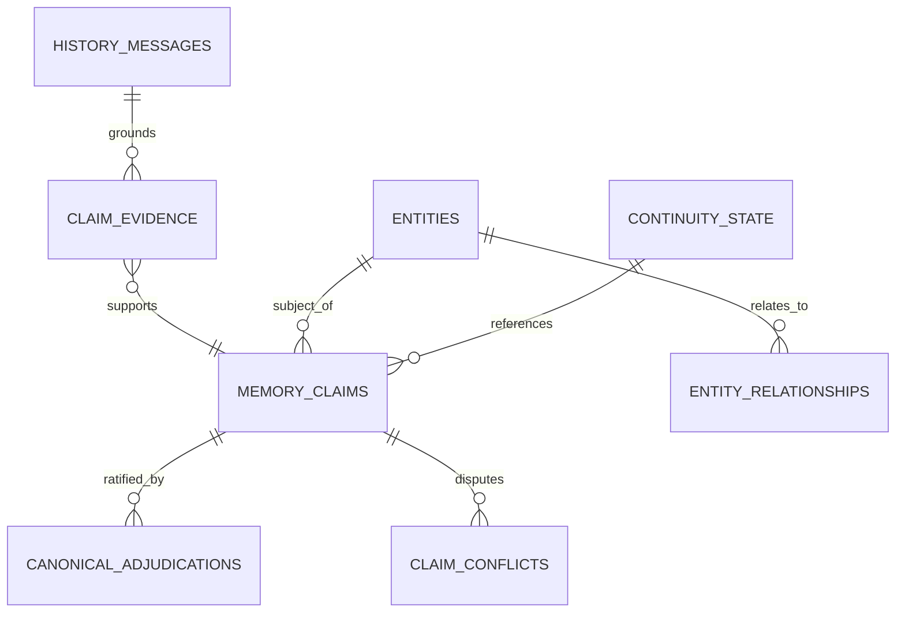

# Chapter 10: The Memory Vault: SQLite Schema, Append-Only Durability, and FTS5

> "Durable memory must distinguish facts, preferences, decisions, historical events, hypotheses, superseded decisions, lessons, relationships, projects, unresolved questions, provenance, confidence, dates, and contradictions. It must not be one indiscriminate vector bucket where all historical text is equal."
> — JOSIE Master Codex Context (Section 4)

In the architecture of modern artificial intelligence, the standard approach to memory is almost universally unstructured: embed raw text chunks into a high-dimensional vector database (such as Pinecone, Chroma, or Weaviate) and perform cosine-similarity searches at runtime. 

Dustin recognized early on that vector databases are fundamentally inadequate for an AI steward. Vector embeddings cannot distinguish between a verified historical event and a hypothetical idea; they cannot tell whether a decision was locked, superseded, or rejected; they cannot enforce temporal validity bounds; and they provide zero mathematical guarantees against hallucinated retrieval.

Josie’s authoritative memory was therefore built on an entirely different foundation: **The SQLite Memory Vault** (`data/josie.db`, `CON-0010`, `CON-0011`, `CON-0012`). This chapter provides a comprehensive technical audit of the Memory Vault, its 51 relational tables, its append-only durability guarantees, and the primacy of FTS5 full-text lexical search over vector approximations.



---

## § 10.1 The Physical Vault: 51 Tables and Bare-Metal Relational Storage

The primary database file of the Josie orchestration system resides at `D:\Josie\data\josie.db`. As established during our preflight system audit, the database measures **112,553,984 bytes** (approximately 107.3 MB) and comprises **51 relational tables**.

The tables are partitioned into five functional clusters:
1. **The Historical Raw Archive (Tier 1):** `history_import_runs`, `history_sources`, `history_conversations`, `history_messages`, `history_attachments`, `history_messages_fts`. These tables house immutable raw text from ChatGPT, Gemini, and local chat exports.
2. **The Candidate Claim Pipeline (Tier 2):** `candidate_extractions`, `claim_evidence`, `claim_conflicts`, `conflict_claims`. These tables manage the staging, validation, and corroboration of proposed claims.
3. **The Canonical Knowledge Graph (Tier 3):** `memory_claims`, `canonical_adjudications`, `entities`, `entity_aliases`, `entity_relationships`. These tables hold human-ratified truths and structured entity relationships.
4. **The Operational Continuity Engine (Tier 4):** `continuity_state`, `jobs`, `tasks`, `approvals`, `audit`, `reminders`, `curiosity_questions`. These tables track real-time working goals, blockers, and execution receipts.
5. **Domain-Specific Stewardship Registries:** `deal_candidates`, `deal_discoveries`, `economic_opportunities`, `prayer_requests`, `prayer_request_changes`, `prayer_request_links`.

By utilizing native SQLite, Josie achieves sub-millisecond query latency, zero external network dependencies, atomic transaction safety (ACID compliance), and complete physical sovereignty. If the host machine loses power, the SQLite Write-Ahead Log (WAL) ensures zero database corruption.

---

## § 10.2 The `memory_claims` Schema: Relational Truth with Engine Constraints

The structural core of the Memory Vault is the `memory_claims` table. Its schema is engineered to make self-adjudication and ungrounded assertion physically impossible:

```sql
CREATE TABLE memory_claims (
    claim_id TEXT PRIMARY KEY,
    subject_entity_id TEXT NOT NULL,
    predicate TEXT NOT NULL,
    object_entity_id TEXT,
    value_text TEXT,
    memory_layer TEXT NOT NULL CHECK (
        memory_layer IN ('identity','semantic','episodic','procedural','relational')
    ),
    status TEXT NOT NULL CHECK (
        status IN ('candidate','active','disputed','superseded','rejected')
    ),
    evidence_class TEXT NOT NULL CHECK (
        evidence_class IN ('VERIFIED','CANONICAL','RETRIEVED','INFERRED','UNKNOWN')
    ),
    authority_scope TEXT NOT NULL,
    confidence REAL NOT NULL CHECK (confidence BETWEEN 0 AND 1),
    confidence_basis TEXT NOT NULL,
    valid_from TEXT,
    valid_to TEXT,
    created_at TEXT NOT NULL,
    updated_at TEXT NOT NULL,
    approved_by TEXT,
    reviewed_at TEXT,
    canonical_effect INTEGER NOT NULL DEFAULT 0 CHECK (
        canonical_effect IN (0,1)
    ),
    superseded_by_claim_id TEXT,
    version INTEGER NOT NULL DEFAULT 1 CHECK (version >= 1),
    durability TEXT NOT NULL DEFAULT 'durable' CHECK (
        durability IN ('durable','current_state','preference','transient')
    ),
    claim_category TEXT,
    CHECK ((object_entity_id IS NULL) != (value_text IS NULL)),
    CHECK (
        canonical_effect = 0 OR (
            status = 'active' AND evidence_class = 'CANONICAL'
            AND approved_by IS NOT NULL AND reviewed_at IS NOT NULL
        )
    ),
    FOREIGN KEY(subject_entity_id) REFERENCES entities(entity_id),
    FOREIGN KEY(object_entity_id) REFERENCES entities(entity_id)
);
```

### The Inviolable CHECK Constraints
Notice the extraordinary mathematical boundaries hard-coded into the DDL:
1. `CHECK ((object_entity_id IS NULL) != (value_text IS NULL))`: A claim must be either an entity-to-entity relationship (e.g., `person:dustin` -> `owns` -> `business:fsv`) OR an entity-to-literal value (e.g., `system:josie` -> `vram_ceiling` -> `'12GB'`). It cannot be both, and it cannot be neither.
2. `CHECK (canonical_effect = 0 OR (status = 'active' AND evidence_class = 'CANONICAL' AND approved_by IS NOT NULL AND reviewed_at IS NOT NULL))`: **The Canonical Gate.** A row cannot have `canonical_effect = 1` unless its status is `'active'`, its evidence class is `'CANONICAL'`, and it contains explicit, non-null `approved_by` and `reviewed_at` timestamps.

An LLM can generate whatever SQL text it hallucinates, but the SQLite engine itself enforces the constitutional law.

---

## § 10.3 Append-Only Durability and the Schema Freeze (`CON-0012`)

In conventional application development, when data changes, developers execute an `UPDATE` statement that overwrites previous values. 

In the Josie Memory Vault, **overwriting historical knowledge is strictly forbidden** (`CON-0012`). Human relationships, business facts, and personal preferences evolve over time. If Dustin preferred Neovim in 2024 but switched to VS Code in 2026, overwriting the 2024 record destroys historical provenance. An AI that forgets what was previously true cannot understand *why* a transition occurred.

The Memory Vault enforces an **append-only temporal model**:
- When a claim is updated, the original claim record is not deleted or overwritten.
- The original claim's `status` is transitioned to `'superseded'`, its `valid_to` column is populated with the timestamp of the change, and its `superseded_by_claim_id` is linked to the new claim.
- A new claim row is inserted with `version = version + 1`, a new `claim_id`, and `valid_from` set to the current time.
- Both records remain permanently preserved in `memory_claims`.

This append-only invariant enables exact **point-in-time reconstruction**. If an auditor asks, *"What did Josie believe about Dustin's supplier agreements on September 15, 2026?"* the system can execute:
```sql
SELECT * FROM memory_claims 
WHERE valid_from <= '2026-09-15T00:00:00Z' 
  AND (valid_to IS NULL OR valid_to > '2026-09-15T00:00:00Z')
  AND canonical_effect = 1;
```
The exact state of canonical truth at that precise second is restored with 100% mathematical fidelity.

---

## § 10.4 Lexical Search Primacy: The SQLite FTS5 Engine (`CON-0011`)

While modern AI frameworks obsess over dense vector embeddings, Josie implements **FTS5 lexical search primacy** (`CON-0011`). 

In `data/josie.db`, the entire historical message corpus is indexed using SQLite’s native Full-Text Search 5 module (`history_messages_fts`). 

Why does lexical search supersede vector embeddings in Josie’s architecture?
1. **Precision on Exact Identifiers:** Vector embeddings operate on semantic fuzziness. If a query searches for an exact part number (`RTX 3060 XC`), a specific SKU (`AIMB-205G2`), an exact date (`2026-08-09`), or an exact legal clause (`DEC-0021`), vector cosine similarity frequently returns vaguely related concepts while missing the exact keyword. FTS5 with BM25 ranking returns the exact hit instantly.
2. **Determinism:** Vector searches vary depending on the embedding model, quantization, and index clustering. FTS5 search results are 100% deterministic, bit-exact, and reproducible across all platforms.
3. **Hardware Headroom:** Running a dense vector search over 30,000 conversational turns requires holding an embedding model in VRAM or CPU RAM. FTS5 executes directly inside the SQLite engine in under 5 milliseconds with negligible memory overhead, preserving the entire 12GB VRAM budget for the resident generalist model.

Vector search is retained as an optional secondary heuristic for open-ended thematic queries, but **lexical precision remains the sovereign primary gate of historical retrieval**.
