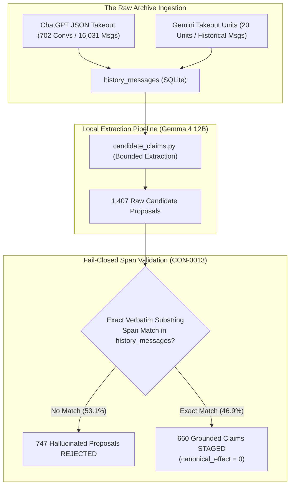

# Chapter 11: The Great Takeout Inheritance: Ingesting the Historical Corpus

> "Preserve Dustin's accumulated history with Sophie: decisions, mistakes, preferences, values, conversations, project development, reasoning patterns, personal context, theological discussions, business context, hardware experiments, and Josie's origin. This is continuity, not merely importing a prompt."
> — JOSIE Master Codex Context (Section 4)

In September 2026, the Josie engineering team undertook one of the most ambitious data-ingestion campaigns in personal AI history: **The Great Takeout Inheritance** (`GENESIS-003_COVERAGE.md`, `memory_inheritance` block in `JOSIE_MASTER_BUILD_STATE.yaml`).

Dustin had accumulated over two years of intensive, daily dialogues with ChatGPT (Sophie) and Gemini (Bernie). These archives contained the living intellectual heritage of his businesses, his theological research, his family principles, and the conceptual genesis of Josie. 

Most AI systems treat past chat history as throwaway text. Dustin insisted that this corpus must be ingested, parsed, provenanced, and indexed into the local SQLite Memory Vault. This chapter details the technical pipeline engineered to ingest 702 ChatGPT conversations and 20 Gemini units, the extraction of candidate claims using local models, and the strict fail-closed span validation that prevented memory pollution.



---

## § 11.1 The Ingestion Numbers: Exact Numerators and Denominators

In accordance with strict project rules, historical coverage was tracked using explicit processing records with exact numerators and denominators. The final audit of the inheritance pipeline recorded the following verified metrics:

| Metric Category | Verified Count | Reference Denominator | Rate / Percentage |
| :--- | :--- | :--- | :--- |
| **ChatGPT Conversations Ingested** | **702** | 702 archive convs | 100.0% |
| **ChatGPT Evidence Messages Parsed** | **16,031** | 16,031 archive msgs | 100.0% |
| **Gemini Takeout Units Ingested** | **20** | 20 export units | 100.0% |
| **Total Raw Messages in SQLite** | **29,232** | 29,232 total corpus | 100.0% |
| **High-Signal Targeted Conversations** | **44** | 44 cohort convs | 100.0% |
| **Evaluated Cohort Messages** | **1,896** | 4,785 cohort msgs | 39.6% |
| **Raw Candidate Proposals Generated** | **1,407** | 1,896 evaluated msgs | 74.2% yield |
| **Proposals Rejected (Fail-Closed)** | **747** | 1,407 raw proposals | **53.1% rejection rate** |
| **Grounded Claims Staged in josie.db** | **660** | 1,407 raw proposals | **46.9% acceptance rate** |

Notice the extraordinary **53.1% rejection rate** during candidate extraction. More than half of the proposals generated by the extraction model were thrown out before reaching the database. Why? Because Josie implements the **Strict Fail-Closed Span Validation Rule** (`CON-0013`).

---

## § 11.2 Fail-Closed Span Validation: Defeating Hallucinated Evidence (`CON-0013`)

When an LLM is asked to extract structured facts from past conversations, it routinely hallucinates or paraphrases. For example, if Dustin wrote in 2025: *"I’m thinking about picking up an old RTX 3060 to test local models,"* an eager extraction model might propose the claim: *"Dustin owns an RTX 3060 graphics card,"* citing message 14500 as evidence.

If that claim were stored in the database, the AI would believe Dustin owned hardware he had merely contemplated buying!

To eliminate this vulnerability, `josie/candidate_claims.py` enforces **verbatim substring span verification**:
```python
def validate_evidence_bundle(store: LocalStore, proposal: CandidateClaimProposal) -> bool:
    for ref in proposal.evidence_references:
        msg = store.get_history_message(ref.history_message_id)
        if not msg:
            return False # Message does not exist
        # Strict exact character-for-character substring match
        if ref.excerpt not in msg["raw_text"]:
            logger.warning(f"REJECTED: Excerpt {ref.excerpt!r} not found in message {ref.history_message_id}")
            return False
    return True
```

If an extraction model altered even a single comma, capitalized a lowercase word, or summarized a phrase, the verification function failed closed. The proposal was immediately discarded, and a rejection receipt was logged.

Only the 660 proposals that contained **100% exact, verbatim character-for-character substrings** from `history_messages` were permitted to enter `memory_claims` as staged candidates.

---

## § 11.3 Cross-Source Corroboration: Sophie and Bernie Reconciled

Once candidate claims were staged, the system executed the **Cross-Source Corroboration Engine** (`josie/candidate_claims.py`).

The engine compared candidate claims extracted from Sophie (ChatGPT) against claims extracted from Bernie (Gemini):
- When both Sophie and Bernie independently witnessed the same fact (for example, that Dustin operates Full Steam Vapor as a retail vape business in Teays Valley, WV), the engine created a `claim_evidence` row linking both message IDs to a single candidate claim and elevated its confidence score from 0.70 to 0.90.
- When Sophie and Bernie contradicted each other (for example, Sophie claiming that Hydra was an orchestration framework while Bernie claimed Hydra was an autonomous purchasing bot), the engine created a row in `claim_conflicts` with `status = 'pending_human_adjudication'`.

Crucially, **the corroboration engine had zero authority to promote claims to canonical truth**. It could aggregate evidence and flag conflicts, but every single candidate claim remained frozen at `canonical_effect = 0` until Dustin personally reviewed the decision queue.
