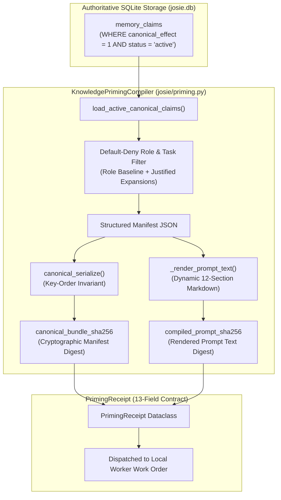

# Chapter 13: Task-Specific Priming and the Dual-Hash Receipt Contract

> "Only ratified canonical claims are incorporated into priming bundles. Raw takeouts and unapproved candidate claims are strictly excluded. The compiler enforces dual-hash receipt semantics: canonical_bundle_sha256 over the manifest, and compiled_prompt_sha256 over the rendered markdown text."
> — josie/priming.py Module Specification

When an artificial intelligence agent is dispatched to write code, analyze data, or draft a response, it requires context. In modern multi-agent systems, context assembly is often handled haphazardly: developers concatenate recent chat logs, inject massive system prompts, and dump top-k vector search results into the prompt window.

This naive approach creates severe security and reliability failures:
- It causes **context window bloat**, wasting memory and increasing inference latency.
- It introduces **distractor text**, confusing the model and degrading reasoning performance.
- It creates **prompt injection attack surfaces**, allowing unverified text to contaminate the worker's operational policy.
- It destroys **reproducibility**, making it impossible to determine which specific knowledge claims influenced a worker's output.

In Roadmap Item 1.3 (`SOPHIE-ROADMAP-003`), the Josie project solved this challenge through the creation of the **Knowledge Priming Compiler** (`josie/priming.py`). This chapter details the compiler's architecture, its default-deny role filtering, the 13-field receipt contract, and the cryptographic dual-hash separation that guarantees bit-exact auditability.



---

## § 13.1 The Default-Deny Role Filtering Engine

The core law of the Knowledge Priming Compiler is **Default-Deny**. A worker model does not receive all canonical knowledge; it receives only the minimal, provably relevant knowledge subset required to execute its specific assigned role.

The compiler establishes strict baseline categories per role:
```python
ROLE_DEFAULT_CATEGORIES = {
    "generalist": ["human_authority", "system_architecture", "system_safety"],
    "code": ["system_architecture", "system_safety", "coding_standards"],
    "researcher": ["human_authority", "evidence_standards"],
    "worker": ["system_safety", "execution_boundaries"],
}
```

When a task work order is compiled:
1. The compiler loads only claims satisfying `canonical_effect = 1 AND status = 'active'`. Candidate claims and rejected witness statements are filtered out at the SQL query level.
2. The claim's category is classified using deterministic predicate mapping.
3. If the category matches the worker's role baseline, it is selected.
4. If a task requires expanding beyond the baseline (for example, a retail task requiring personal business claims), the expansion must be justified by explicit domain keywords in the task objective (`"business"`, `"vape"`, `"retail"`) or explicit task claim IDs passed by the human supervisor.
5. All unrelated categories (e.g., personal finances, medical records, or pastoral prayer registries) remain **strictly excluded**.

---

## § 13.2 The 13-Field Priming Receipt Contract

To guarantee complete post-execution auditability, every execution of `compile_bundle()` generates a strongly typed `PrimingReceipt` dataclass. The receipt contract specifies thirteen mandatory fields:

1. `bundle_id`: Unique identifier (e.g., `BUNDLE-D0E2481126C9`).
2. `canonical_bundle_sha256`: 64-character SHA-256 digest of the canonically serialized manifest.
3. `compiled_prompt_sha256`: 64-character SHA-256 digest of the rendered markdown prompt text.
4. `task_mission_id`: The exact parent mission identifier.
5. `target_role`: The assigned operational role (`generalist`, `code`, etc.).
6. `schema_version`: Priming compiler schema specification (e.g., `1.1.0`).
7. `canonical_serialization_version`: Serialization algorithm standard (e.g., `1.0.0`).
8. `algorithm_version`: Compiler logic version (`1.2.0`).
9. `selected_claim_ids`: Array of exact claim IDs included in the bundle.
10. `selected_claim_ids_with_versions`: Array of claim IDs paired with their exact database version numbers (e.g., `identity:dustin-authority:v1`).
11. `retrieved_source_ids`: Mapping of underlying evidence source files and their SHA-256 checksums.
12. `explicit_priming_categories`: The allowed category list governing the compilation.
13. `reproducibility_token`: Cryptographic token confirming that identical inputs will produce bit-for-bit identical output.

---

## § 13.3 Cryptographic Dual-Hash Separation: Manifest vs. Prompt

A crucial mathematical breakthrough in Josie’s architecture is **Cryptographic Dual-Hash Separation**:
$$\text{canonical\_bundle\_sha256} \neq \text{compiled\_prompt\_sha256}$$

Why are two separate hashes required?
- **The Manifest Hash (`canonical_bundle_sha256`):** Computed strictly over the normalized, sorted JSON manifest containing the underlying canonical claims, their version numbers, and their source provenance. This hash represents the *semantic and factual truth* provided to the worker.
- **The Prompt Hash (`compiled_prompt_sha256`):** Computed over the final rendered Markdown prompt text, including instruction wrappers, role guidelines, and task-specific formatting.

This separation prevents a critical auditing failure. If a developer modifies a prompt wrapper instruction (for example, changing *"Output in JSON"* to *"Output in YAML"*), the rendered prompt changes, altering `compiled_prompt_sha256`. However, because the underlying canonical claims did not change, `canonical_bundle_sha256` remains **100% identical**. 

An auditor can instantly verify whether an operational divergence was caused by a change in *factual knowledge* or merely a change in *prompt phrasing*.

---

## § 13.4 Key-Order Invariance in Canonical Serialization

In JSON serialization, dictionary keys can be emitted in arbitrary order depending on the programming language runtime. If one system serializes `{"role": "coder", "claims": [...]}` and another serializes `{"claims": [...], "role": "coder"}`, the resulting byte strings will produce completely different SHA-256 hashes, destroying reproducibility.

The Knowledge Priming Compiler solves this via `canonical_serialize()`:
```python
def canonical_serialize(data: Any) -> bytes:
    '''Deterministically serialize nested structures with sorted keys and UTF-8 encoding.'''
    return json.dumps(
        data,
        sort_keys=True,
        ensure_ascii=False,
        separators=(',', ':')
    ).encode('utf-8')
```

As demonstrated in acceptance test `C1-06`, permuting the keys of a manifest produces **bit-exact identical SHA-256 digests**. Josie’s priming manifests are mathematically immutable across all platforms and operating systems.
