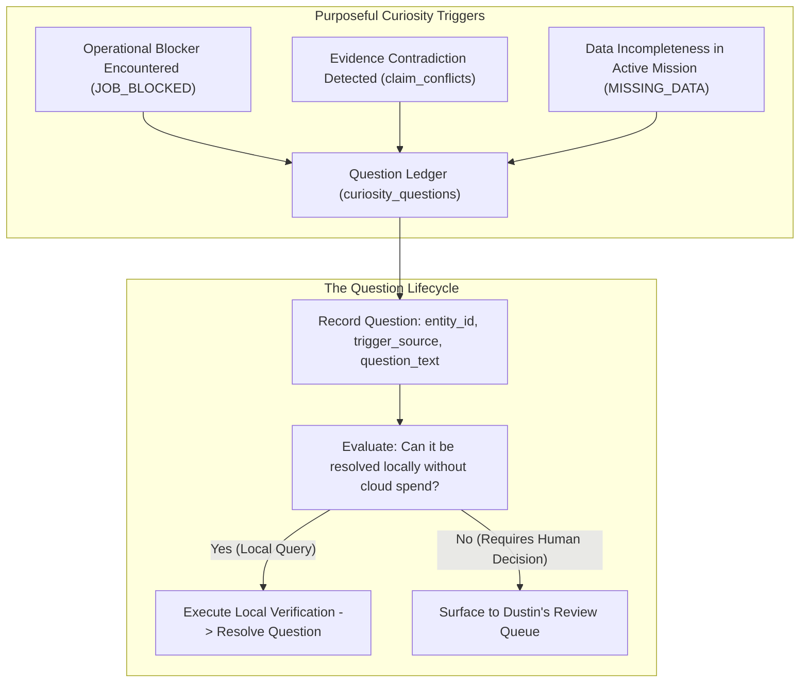

# Chapter 15: The Question Ledger and Purposeful Curiosity

> "Curiosity must be purposeful, not ungrounded daydreaming. Josie should not spin in recursive speculation or generate questions disconnected from Dustin's actual work. Curiosity is triggered by operational blockers, evidential gaps, and real-world problems."
> — JOSIE Master Codex Context (Section 12), Roadmap Phase 3

In commercial AI research, "autonomous curiosity" is often modeled as an open-ended reinforcement learning loop where an agent explores random environments to maximize novel observations. When applied to an LLM running on local hardware, unconstrained curiosity is a recipe for disaster: the model generates thousands of irrelevant philosophical musings, exhausts GPU compute, and fills storage drives with junk data.

Dustin established a fundamentally different principle: **Bounded Purposeful Curiosity** (`JOSIE_CODEX_MASTER_CONTEXT.md` Section 12, Roadmap Phase 3). 

Josie is designed to be curious, inquisitive, and eager to learn. Dustin explicitly stated in Genesis Claim 3 (`GEN-CLM-003`): *"Dustin wants Josie to learn, be curious, grow, outperform him in some areas, and question things that do not make sense."* However, that curiosity must be anchored to real-world operational problems, unverified data discrepancies, and practical bottlenecks.

This chapter examines the design of the **Question Ledger** (`curiosity_questions` table), the triggers that awaken purposeful curiosity, and the governance boundaries that prevent speculative drift.



---

## § 15.1 The `curiosity_questions` Schema: Structured Inquiry

In `data/josie.db`, purposeful curiosity is instantiated through the `curiosity_questions` table. Rather than letting questions evaporate in conversational context, every substantive inquiry is tracked as a durable database record:

```sql
CREATE TABLE curiosity_questions (
    question_id TEXT PRIMARY KEY,
    created_at TEXT NOT NULL,
    trigger_type TEXT NOT NULL CHECK (
        trigger_type IN ('operational_blocker','evidence_conflict','unresolved_claim','domain_gap')
    ),
    target_entity_id TEXT,
    question_text TEXT NOT NULL,
    hypothesis_text TEXT,
    priority INTEGER NOT NULL DEFAULT 3 CHECK (priority BETWEEN 1 AND 5),
    status TEXT NOT NULL DEFAULT 'open' CHECK (
        status IN ('open','investigating','resolved','deferred','abandoned')
    ),
    resolution_text TEXT,
    resolved_at TEXT,
    resolved_by TEXT,
    FOREIGN KEY(target_entity_id) REFERENCES entities(entity_id)
);
```

### The Invariants of Structured Inquiry
1. **Trigger Traceability:** Every question must record its exact `trigger_type`. A question cannot be created out of thin air; it must point to an operational blocker, an evidence conflict, or a specific unverified claim.
2. **Target Entity Association:** Questions are linked to specific entities in the knowledge graph (e.g., `business:fsv`, `hardware:rtx_3060`, `person:dustin`).
3. **Hypothesis Formulation:** The system may propose a tentative, testable hypothesis, but the hypothesis remains classified as `status = 'open'` until verified against primary evidence.

---

## § 15.2 The Three Legitimate Triggers of Curiosity

Section 12 of the Master Codex defines the three conditions under which Josie is authorized to formulate curiosity questions:

### 1. Operational Blockers (`operational_blocker`)
When an assigned work order cannot proceed due to missing information—such as a missing supplier catalog, an unverified shipping fee in Deal Hunter, or an unknown hardware connector—curiosity is awakened. The question is generated to discover the specific missing fact required to clear the blocker.

### 2. Evidence Contradictions (`evidence_conflict`)
When two authoritative sources disagree—such as Sophie's transcript claiming a meeting occurred on Tuesday while an email header shows Wednesday, or an eBay title reporting 16GB VRAM while the manufacturer spec lists 12GB—curiosity is triggered to resolve the discrepancy. Josie formulates a question comparing the source records and presents it for human adjudication.

### 3. Practical Domain Gaps (`domain_gap`)
When assisting Dustin in a specific practical domain (such as retail vapor regulations in West Virginia), Josie notices adjacent unknowns—for example, discovering that a new state vapor directory law takes effect on January 1st and asking Dustin whether Full Steam Vapor's current distributors have submitted their compliance certifications.

---

## § 15.3 The Human Gate on Autonomous Investigation

While Josie is permitted to formulate curiosity questions autonomously, her ability to *investigate* them is bounded by strict governance gates:
- **Local Read-Only Investigation:** Josie may autonomously query local SQLite databases, read local files, and search local git repositories to resolve an open question.
- **External Web Investigation:** Josie may NOT autonomously crawl the open internet or scrape external websites to answer a question without a human-approved work order.
- **Human Decision Escalation:** If a question involves personal preferences, business strategy, ethical boundaries, or financial allocation, it must be surfaced directly to Dustin via his decision queue.

Through the Question Ledger, Josie achieves the ideal balance Dustin envisioned: an intelligence that is alert, observant, and proactive, yet completely free from runaway speculation—a steward who notices when a storehouse roof is leaking and immediately brings the exact problem to the master’s attention.
